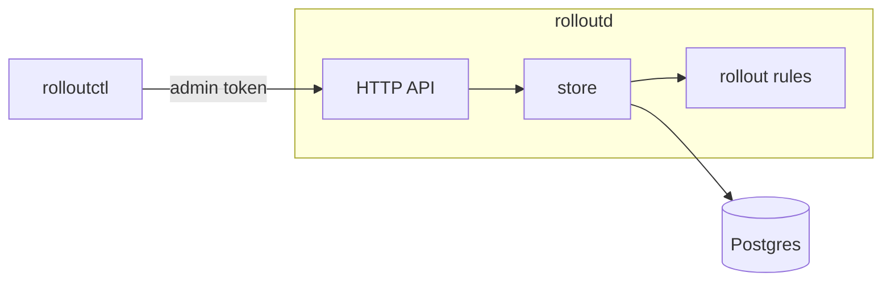
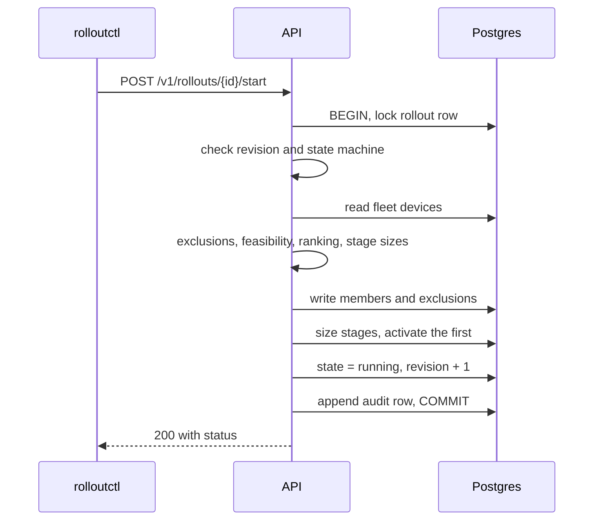
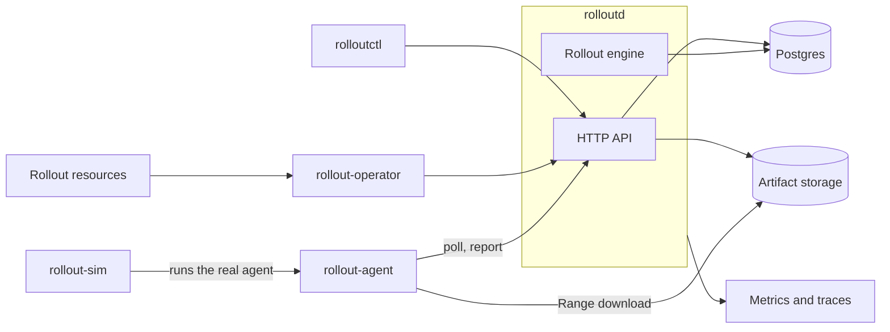

# Architecture

This describes what's built today, followed by what's planned. Everything under
[Planned](#planned) is design, not code.

## Today

| Package | Responsibility |
|---|---|
| `cmd/rolloutd` | Server binary: `serve` and `migrate` |
| `cmd/rolloutctl` | Operator command line |
| `internal/rollout` | Pure rules: ranking, policy validation, membership, and the state machine. No database or network. |
| `internal/store` | Postgres persistence. Methods own their transactions, so callers can't split work that must commit together. |
| `internal/db` | Connection pool, embedded migrations, and schema readiness |
| `internal/api` | HTTP handlers, admin authentication, and error mapping |
| `internal/apiv1` | JSON documents shared by the server and client |
| `internal/client` | Go client for the admin API. The CLI uses it, and the operator will. |
| `internal/auth` | Admin token verification and device token generation |
| `internal/testdb` | Gives each test its own database on a real Postgres server |

### Where correctness lives

A rule that must hold under concurrency, or despite an application bug, is enforced in Postgres
wherever possible:

| Guarantee | Mechanism |
|---|---|
| One active rollout per fleet | Partial unique index |
| Policy and identity never change | `BEFORE UPDATE` trigger |
| Every update advances the revision by one | `BEFORE UPDATE` trigger |
| Finished rollouts never change | `BEFORE UPDATE` trigger |
| Starting is one-way, and its member count and time are fixed | `BEFORE UPDATE` trigger |
| Membership and stage sizes frozen after start | Triggers on insert, update, and delete |
| Audit log and device events are append only | `BEFORE UPDATE OR DELETE` triggers |
| One open assignment per device | Partial unique index |
| A report sequence is used once per device | Unique constraint |

`internal/rollout` holds rules that are easier to express and test in Go. Each store method applies
them inside the transaction that writes the result.

### Starting a rollout

If any step fails, the transaction rolls back and the rollout stays a draft. A second rollout on the
same fleet fails on the unique index, even if two requests pass the earlier check at the same time.

### Time

Soak and deadline timers use timestamps from an injected clock, so tests control time instead of
sleeping. Pausing banks the soak time so far and stops the timer. Resuming restarts the timer and
moves the stage deadline later by the length of the pause.

## Planned

- **Engine.** One active instance holds a fenced lease in Postgres ([ADR 0004](adr/0004-transitions-and-engine-fencing.md)), and rebuilds all its state from the database after a restart.
- **Agent.** Polls with jitter ([ADR 0002](adr/0002-pull-based-device-model.md)), resumes downloads from verified data, and persists a checkpoint at each step, so a crash during installation is recoverable.
- **Simulator.** Runs the same agent state machine, replacing only transport, installation, and time.
- **Operator.** Calls the same API as the CLI and holds no rollout rules of its own.

Stage progression, reports, and rollback semantics are specified in
[rollout-semantics.md](rollout-semantics.md).
