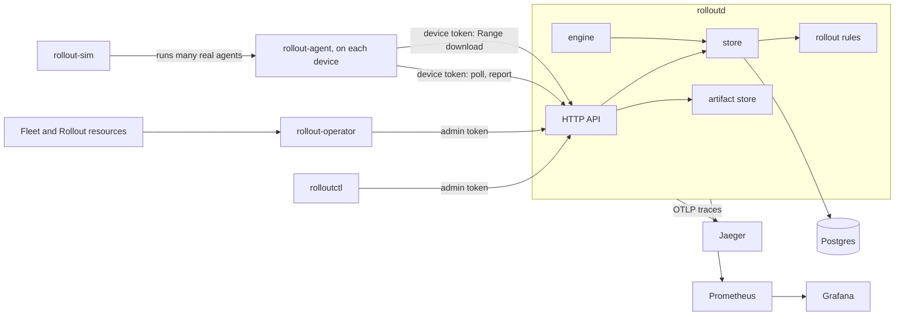
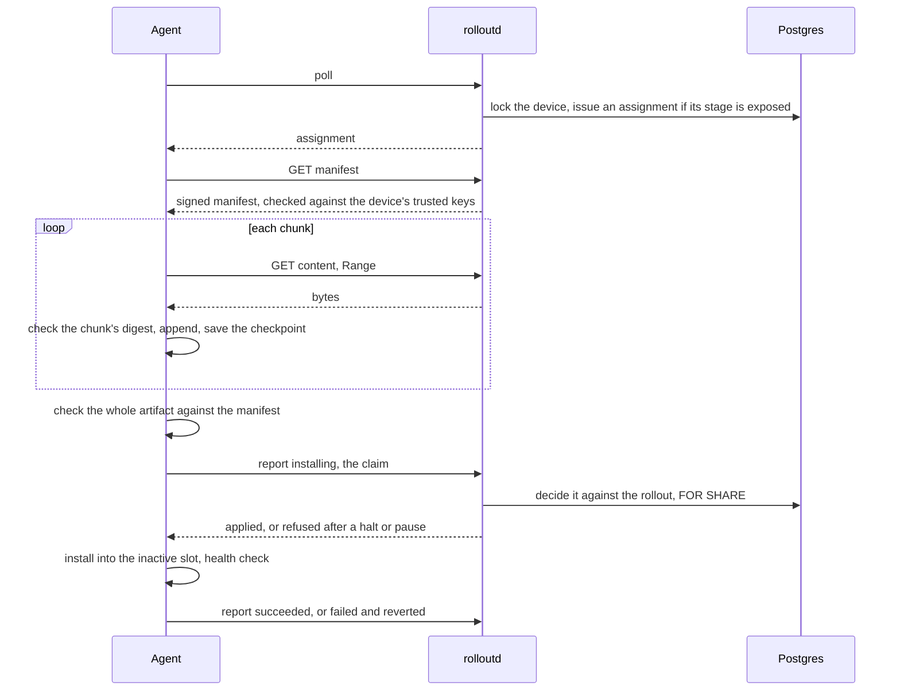
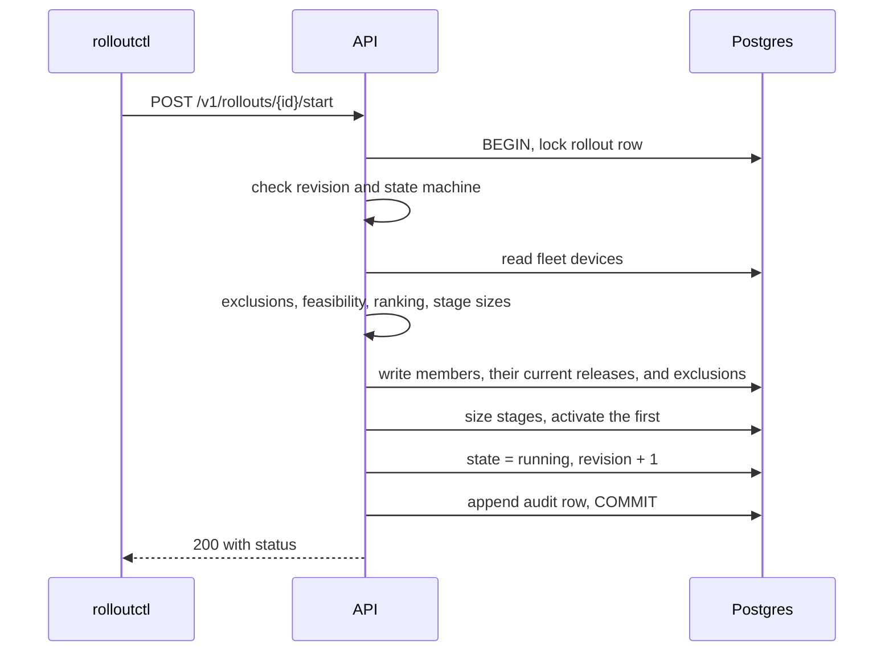
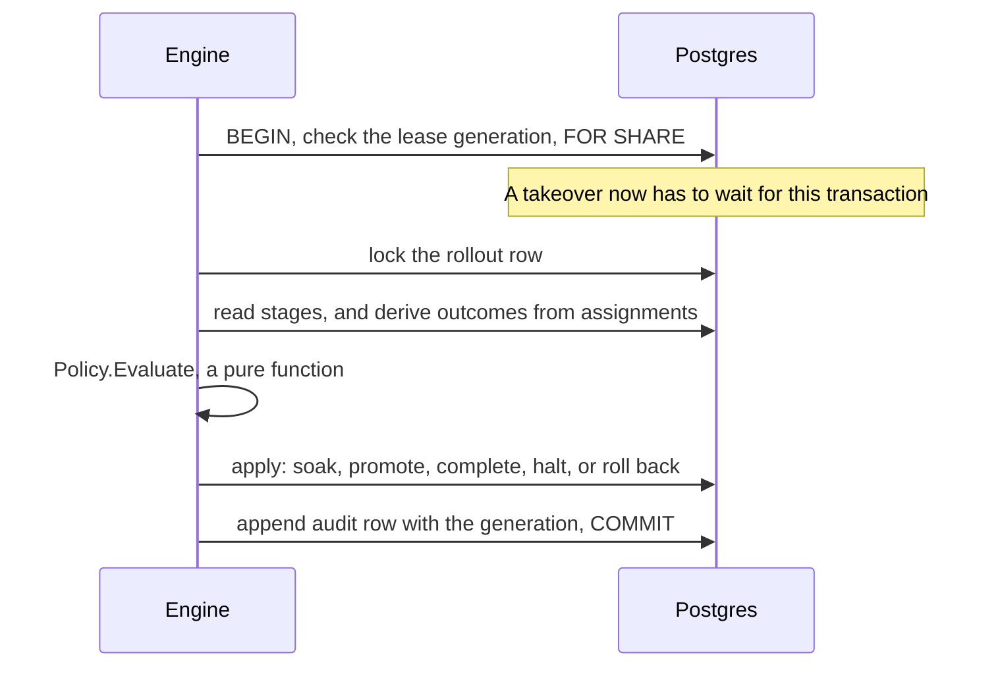

# Architecture

fleet-rollout has one server, `rolloutd`, that owns every decision, and clients that only ask it things:
devices, the command line, and the Kubernetes operator. Postgres is the only durable state
([ADR 0001](adr/0001-postgres-as-the-only-authority.md)). Everything here is built. The README lists the
limitations.

Devices pull ([ADR 0002](adr/0002-pull-based-device-model.md)): they poll for work, download in verified chunks,
ask before they install, and report what happened. The server never reaches out to a device, so a device that's
offline only delays its own part. Any number of rolloutd instances can serve devices. One at a time runs the
engine, under a fenced lease ([ADR 0004](adr/0004-transitions-and-engine-fencing.md)).

## Binaries

| Binary | What it does |
|---|---|
| `rolloutd` | The control plane: `serve` runs the API and the engine, and `migrate` applies the schema. |
| `rolloutctl` | The operator command line: fleets, devices, artifacts, keys, and rollouts. |
| `rollout-agent` | Runs on a device. Installation is simulated: artifacts are opaque bytes written into slots. |
| `rollout-operator` | Turns `Fleet` and `Rollout` resources into API calls ([ADR 0010](adr/0010-kubernetes-operator.md)). |
| `rollout-sim` | Runs fleets of the real agent with faults injected around it, deterministically or live. |

`go run ./test/bench` measures the system. It isn't shipped. See [benchmarks.md](benchmarks.md).

## Packages

| Package | Responsibility |
|---|---|
| `internal/rollout` | Pure rules: ranking, policy validation, membership, the state machine, assignment progress, and stage evaluation. No database or network. |
| `internal/store` | Postgres persistence. Methods own their transactions, so callers can't split work that must commit together. |
| `internal/engine` | The evaluation loop and leadership. Holds no rollout state. |
| `internal/api` | HTTP handlers, admin and device authentication, load shedding, and error mapping |
| `internal/apiv1` | JSON documents shared by the server and its clients |
| `internal/client` | Go clients for the admin and device APIs, used by the CLI, agent, operator, and simulator |
| `internal/agent` | The device side: a step-driven state machine over a durable checkpoint ([ADR 0008](adr/0008-step-driven-agent-and-simulator.md)) |
| `internal/signing` | Signed artifact manifests: DSSE envelopes, Ed25519, per-chunk digests ([ADR 0007](adr/0007-signed-artifact-manifests.md)) |
| `internal/artifactstore` | Artifact bytes, on the filesystem or in memory |
| `internal/operator` | The Kubernetes reconcilers. `api/v1alpha1` holds the resource types. |
| `internal/sim` | Simulated devices: the real agent, with the network, storage, installer, and clock replaced |
| `internal/metrics`, `internal/tracing` | Prometheus metrics and OpenTelemetry traces ([ADR 0012](adr/0012-observability.md)) |
| `internal/db` | Connection pool, embedded migrations, schema readiness, and scratch databases |
| `internal/config` | rolloutd's settings, from the environment, all checked at once |
| `internal/auth`, `internal/retry` | Credentials, and backoff with jitter |
| `internal/cli` | rolloutctl's commands |
| `internal/testdb`, `test/e2e`, `test/kind` | A database per test, whole rollouts through real processes, and the chart on kind |

## One device's update

The agent saves a checkpoint before each step that matters, so a crash or a killed process resumes from the
last verified chunk, and an install it can't prove finished is reverted. It installs only after the server
applies its claim ([ADR 0009](adr/0009-installs-need-the-servers-agreement.md)). So once a halt commits, no
device starts installing, and the server always knows who might be mid-install. Reports carry a per-device
sequence number, so a retry or a duplicate changes nothing.

## Where correctness lives

A rule that must hold under concurrency, or despite an application bug, is enforced in Postgres
wherever possible:

| Guarantee | Mechanism |
|---|---|
| One active rollout per fleet | Partial unique index |
| Policy and identity never change | `BEFORE UPDATE` trigger |
| Every update advances the revision by one | `BEFORE UPDATE` trigger |
| Finished rollouts never change | `BEFORE UPDATE` trigger |
| Starting is one-way, and its member count and time are fixed | `BEFORE UPDATE` trigger |
| Membership and stage sizes frozen after start | Triggers on insert, update, and delete |
| Audit log and device events are append only | `BEFORE UPDATE OR DELETE` triggers |
| One open assignment per device | Partial unique index |
| One forward assignment per device per rollout, so an outcome can't count twice | Partial unique index |
| A rollback assignment names what to restore, and a forward one doesn't | Check constraints |
| A report sequence is used once per device | Unique constraint |
| A stale engine can't commit a decision | Shared lock on the lease row, taken first in every engine transaction |
| No assignment or install claim after a pause or halt commits | Shared lock on the rollout row when issuing or deciding a claim |

`internal/rollout` holds rules that are easier to express and test in Go. Each store method applies
them inside the transaction that writes the result.

## Starting a rollout

If any step fails, the transaction rolls back and the rollout stays a draft. A second rollout on the
same fleet fails on the unique index, even if two requests pass the earlier check at the same time.
Each member's current release is recorded here, which is what a rollback later restores
([ADR 0003](adr/0003-cohorts-and-frozen-membership.md), [ADR 0011](adr/0011-rollback.md)).

## One engine decision

Because outcomes are read from assignments each time, there are no counters to drift or to lose in a
crash, and a duplicate report has nothing to double count. rolloutd runs the same `Evaluate` to say what a
rollout is waiting for, which `rolloutctl rollout status` shows, so the explanation can't disagree with the
decision.

A halt stops new exposure and cancels work that hasn't reached installation, in the same transaction. With
`on_breach: rollback`, the same transaction starts a rollback too: every device that updated gets a rollback
assignment on its next poll, restores its previous slot under a claim, and reports. The engine finishes the
rollback when every device is restored or failed, or marks it incomplete at its deadline
([ADR 0011](adr/0011-rollback.md)).

## Locks

Everything a device does starts by updating its own row, which serializes its polls and reports and
gives them the same lock order: device, then assignment. Transitions and the engine go rollout, then
assignment.

A report also takes a key-share lock on the rollout row, from the foreign key on its event, while holding
its assignment. So the engine and transitions lock the rollout row with `FOR NO KEY UPDATE`, not
`FOR UPDATE`. That doesn't conflict with a key-share lock, and it still blocks the shared lock a poll takes
when issuing work. With `FOR UPDATE`, a report and a halt could deadlock.

## Load

Device requests take a slot from a fixed pool before they touch Postgres, and get `503` with a jittered
`Retry-After` when the pool is full. Downloads have a pool of their own, so slow links can't crowd out reports.
Devices poll with jitter and back off with jitter, so a fleet that reconnects together spreads out again. The
rollout metrics read Postgres at most once every five seconds however often they're scraped.
[benchmarks.md](benchmarks.md) has the measured limits.

## Time

Soak and deadline timers use timestamps from an injected clock, so tests control time instead of
sleeping. Pausing banks the soak time so far and stops the timer. Resuming restarts the timer and
moves the stage deadline later by the length of the pause. The deterministic simulator runs the server,
the engine, and every agent on one goroutine against a fake clock, which is why a seed reproduces a whole
run exactly.

## Deployment

| Where | What runs |
|---|---|
| Local, the README's quick start | Postgres in Compose. rolloutd, agents, and the simulator as local processes. |
| `make obs-up` | rolloutd, Postgres, Prometheus, Grafana, and Jaeger in Compose, on loopback |
| Kubernetes | The Helm chart: rolloutd with a migration init container, the operator with leader election, the CRDs, and an optional Postgres. `make test-kind` runs it on kind. |

rolloutd doesn't terminate TLS, and binds to loopback unless `ROLLOUTD_ALLOW_NON_LOOPBACK=true`. In a cluster,
TLS belongs to the ingress in front of it.
