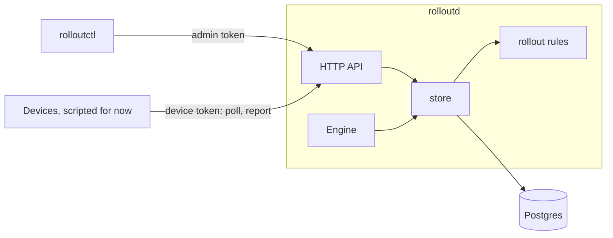
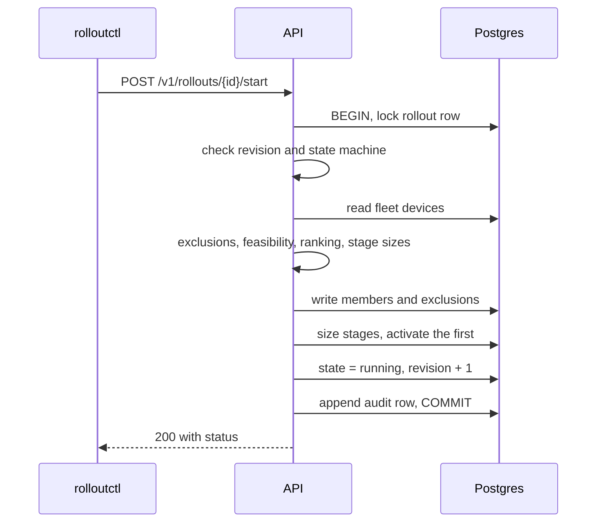
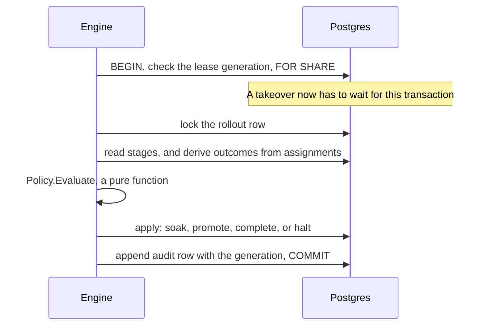
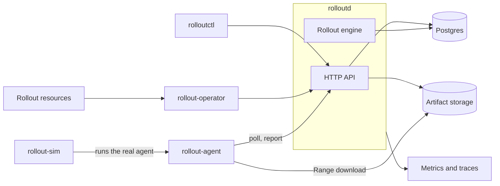

# Architecture

This describes what's built today, followed by what's planned. Everything under
[Planned](#planned) is design, not code.

## Today

| Package | Responsibility |
|---|---|
| `cmd/rolloutd` | Server binary: `serve` and `migrate`. Runs the API and an engine. |
| `cmd/rolloutctl` | Operator command line |
| `internal/rollout` | Pure rules: ranking, policy validation, membership, the state machine, assignment progress, and stage evaluation. No database or network. |
| `internal/store` | Postgres persistence. Methods own their transactions, so callers can't split work that must commit together. |
| `internal/engine` | The evaluation loop and leadership. Holds no rollout state. |
| `internal/db` | Connection pool, embedded migrations, and schema readiness |
| `internal/api` | HTTP handlers, admin and device authentication, and error mapping |
| `internal/apiv1` | JSON documents shared by the server and client |
| `internal/client` | Go clients for the admin and device APIs. The CLI uses the first, and the agent and operator will use them. |
| `internal/auth` | Admin token verification and device token generation |
| `internal/testdb` | Gives each test its own database on a real Postgres server |
| `test/e2e` | Whole rollouts through the real API, store, and engine |

### Where correctness lives

A rule that must hold under concurrency, or despite an application bug, is enforced in Postgres
wherever possible:

| Guarantee | Mechanism |
|---|---|
| One active rollout per fleet | Partial unique index |
| Policy and identity never change | `BEFORE UPDATE` trigger |
| Every update advances the revision by one | `BEFORE UPDATE` trigger |
| Finished rollouts never change | `BEFORE UPDATE` trigger |
| Starting is one-way, and its member count and time are fixed | `BEFORE UPDATE` trigger |
| Membership and stage sizes frozen after start | Triggers on insert, update, and delete |
| Audit log and device events are append only | `BEFORE UPDATE OR DELETE` triggers |
| One open assignment per device | Partial unique index |
| One forward assignment per device per rollout, so an outcome can't count twice | Partial unique index |
| A report sequence is used once per device | Unique constraint |
| A stale engine can't commit a decision | Shared lock on the lease row, taken first in every engine transaction |
| No assignment after a pause or halt commits | Shared lock on the rollout row when issuing |

`internal/rollout` holds rules that are easier to express and test in Go. Each store method applies
them inside the transaction that writes the result.

### Starting a rollout

If any step fails, the transaction rolls back and the rollout stays a draft. A second rollout on the
same fleet fails on the unique index, even if two requests pass the earlier check at the same time.

### One engine decision

Because outcomes are read from assignments each time, there are no counters to drift or to lose in a
crash, and a duplicate report has nothing to double count. `rolloutctl rollout status` runs the same
`Evaluate` to explain what a rollout is waiting for, so the explanation can't disagree with the decision.

### Locks

Everything a device does starts by updating its own row, which serializes its polls and reports and
gives them the same lock order: device, then assignment. Transitions and the engine go rollout, then
assignment.

A report also takes a key-share lock on the rollout row, from the foreign key on its event, while holding
its assignment. So the engine and transitions lock the rollout row with `FOR NO KEY UPDATE`, not
`FOR UPDATE`. That doesn't conflict with a key-share lock, and it still blocks the shared lock a poll takes
when issuing work. With `FOR UPDATE`, a report and a halt could deadlock.

### Time

Soak and deadline timers use timestamps from an injected clock, so tests control time instead of
sleeping. Pausing banks the soak time so far and stops the timer. Resuming restarts the timer and
moves the stage deadline later by the length of the pause.

## Planned

- **Agent.** Polls with jitter ([ADR 0002](adr/0002-pull-based-device-model.md)), resumes downloads from verified data, and persists a checkpoint at each step, so a crash during installation is recoverable. It starts installing only once the server accepts its request ([ADR 0009](adr/0009-installs-need-the-servers-agreement.md)), so the server always knows who is in flight.
- **Operator.** Turns `Fleet` and `Rollout` resources into calls to the same API as the CLI, and holds no rollout rules of its own ([ADR 0010](adr/0010-kubernetes-operator.md)). A `Rollout`'s UID is its rollout's ID, so creating one is idempotent.
- **Simulator.** Runs the same agent, replacing only transport, installation, storage, and time. `rollout-sim fleet` runs real agents for devices that are already registered, so a rollout started by the operator or the CLI has devices to carry it out.

Rollback semantics are specified in [rollout-semantics.md](rollout-semantics.md), along with everything
that's already built.
